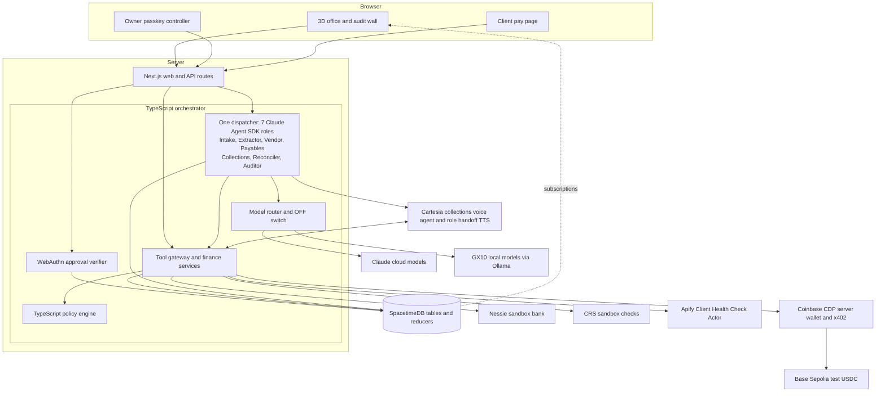

<p align="center">
  <a href="https://youtu.be/dm1FlQTZYT8"></a>
</p>

<h1 align="center">Backrooms</h1>

<p align="center"></p>

<p align="center">
  <strong>Your back office, with every decision in view.</strong><br>
  AI agents handle finance work for a small business. A human approves anything outside their limits.
</p>

<p align="center">
  
  
  
  
</p>

<p align="center">
  <a href="https://youtu.be/dm1FlQTZYT8"><strong>Watch the demo</strong></a> ·
  <a href="https://devpost.com/software/backrooms-h4o783">Devpost</a> ·
  <a href="#what-you-can-do">Capabilities</a> ·
  <a href="#the-whole-system">Architecture</a> ·
  <a href="#run-it">Run it</a> ·
  <a href="#the-receipts">Evidence</a>
</p>

<p align="center"><sub>Real application screenshot from our <a href="https://devpost.com/software/backrooms-h4o783">Devpost gallery</a>. Company data is synthetic; bank and credit integrations use sandboxes, and x402 uses testnet.</sub></p>

---

Late invoices, vendor bills and bank-detail changes pile up when a small business has no finance team. Backrooms gives that work a place: a 3D office where specialist agents pass cases between desks, ask the owner for approval and leave a record you can question.

Built at **Cal Hacks 13.0** by **Abduaziz Umarov, Tomiwa Aluko, Diego Mendoza and Anthony Terry**. The [published project story](https://devpost.com/software/backrooms-h4o783) and [demo video](https://youtu.be/dm1FlQTZYT8) show the team's presentation. This repository contains the implementation, setup guides and scoped test receipts.

<a id="inspiration"></a>

## From Inbox To Audit Wall

A client asks to split an overdue invoice into seven payments, with 15% up front. The Collections agent can discuss the request, but it cannot grant itself a larger limit. Policy escalates the plan to Dana, the owner. Her passkey decision lets the call continue with the exact approved terms. A payment link carries that amount to the pay page; reconciliation checks the deposit against the invoice.

Meanwhile, a lookalike vendor email asks to change bank details. Payables holds it for review before any bank effect. Both stories end on the same audit wall, with the rule, decision and evidence attached. The office makes the handoff visible. It never authorizes it.

**Claude talks, code decides.** Emails, invoices and client speech are data. Models handle language; code controls limits, approvals, payments and the record.

<a id="features"></a>

## What You Can Do

| Experience | How it works |
| --- | --- |
| **Watch the office work** | Explore the React Three Fiber office or its floor plan. Start the workday to see invoice cases move through the existing dispatcher. [Office](docs/office-view.md) · [Agent handoffs](docs/agents.md) |
| **Negotiate within a badge** | Cartesia handles the collections conversation. Server tools enforce disclosure, consent, identity before amount, calling hours, opt-out and bankruptcy stops. [Voice setup and limits](#cartesia-setup-features-and-limitations) |
| **Approve with a passkey** | Requests outside an agent's limits go to the owner. The server verifies a WebAuthn assertion; voice cannot approve. [Approval flow](docs/m6-approvals.md) |
| **Inspect a suspicious invoice** | The inbox and Attack Lab expose policy holds for lookalike senders, missing POs, duplicates and bank changes. [Attack demo](docs/attack-demo.md) |
| **Pay and reconcile** | Approved plan amounts bind the payment link. Nessie sandbox deposits require an exact match; an optional Coinbase CDP wallet pays an approved invoice using x402 on Base Sepolia. [Nessie](docs/m7-payments.md) · [x402 testnet](docs/x402.md) |
| **Ask why** | Answers cite hash-chained audit entries. Citation validation rejects invented entries. [Audit voice](docs/ask-why-voice.md) |
| **Switch models off** | The global OFF switch stops model work while deterministic policy checks keep enforcing holds. [LLM control](docs/llm-control.md) |

<a id="architecture"></a>

## The Whole System

**The browser shows the work. The orchestrator coordinates it. Policy and passkeys control what can happen. SpacetimeDB records the transitions.**



Seven roles share one dispatcher and one handoff store. Role tools expose only the operations that role needs. Handoffs validate their destination and evidence references before the dispatcher commits them. [Runtime and role contracts](docs/agents.md).

The gateway checks policy and trusted state before external effects. Approvals require the server's passkey verifier. SpacetimeDB reducers own state transitions, while the office subscribes and renders. Some gateway and finance repositories remain in memory even when the StateStore uses SpacetimeDB. [State boundaries](#spacetimedb-architecture).

The GX10 serves local models for routine work, including extraction. Cloud routes, fallback labels, budgets and the OFF switch remain explicit. Local inference is separate from the Cartesia phone path. [Model router](orchestrator/README.md#model-router) · [GX10 evidence](docs/t10-gx10.md).

<a id="getting-started"></a>

## Run It

You need **Node.js 22+ and pnpm**. The repository pins its package-manager version in `package.json`.

```sh
git clone https://github.com/azizu06/backrooms.git
cd backrooms
pnpm install
pnpm -r build
pnpm -r test
```

### Start without credentials

```sh
pnpm dev:web
```

Open [localhost:3000/office](http://localhost:3000/office) for the office preview with labelled simulated state. No database or provider keys are needed for this mode.

<a id="what-is-real-in-democore"></a>

To run the deterministic server loop in the terminal:

```sh
pnpm demo:core
```

This exercises policy, approval verification, payment matching and audit with **scripted call turns, a software test authenticator and fake bank HTTP**. It makes no model or sponsor requests. [Exact flow and adapter boundaries](docs/core-demo.md).

### Connect the demo host

The full host needs the SpacetimeDB CLI and its local runtime, plus the setup in the [demo runbook](docs/demo-runbook.md). `pnpm demo:up` starts owned local state by default; Maincloud is opt-in. The runbook covers ports, operator access, passkey enrollment, reset and shutdown.

Copy `.env.example` to ignored `.env.local` only when configuring integrations. Keep credentials server-side. Follow each provider's guide rather than enabling every adapter at once:

| Integration | Setup |
| --- | --- |
| State and office subscriptions | [SpacetimeDB module](spacetime/README.md) · [Host runbook](docs/demo-runbook.md) |
| Claude and GX10 | [Model router](orchestrator/README.md#model-router) · [Agent runtime](docs/agents.md) |
| Cartesia calls and handoff voices | [Cartesia](docs/cartesia.md) · [Call evidence](docs/t1-cartesia.md) |
| Human approval | [Passkey setup](docs/m6-approvals.md) |
| Sandbox payments | [Nessie](docs/t4-nessie.md) · [Pay and reconcile](docs/m7-payments.md) |
| Coinbase testnet payments | [CDP wallet and x402](docs/x402.md#coinbase-payment-agents), with Mac Keychain credentials |
| Public-web checks | [Apify Actor](apify/client-health-check/README.md) |

A configured service is not a completed call or payment. Use only authorized test targets and keep sandbox, cached and simulated labels visible.

<a id="highlights"></a>

## The Receipts

| Evidence | What it establishes |
| --- | --- |
| [Published demo](https://youtu.be/dm1FlQTZYT8) and [project story](https://devpost.com/software/backrooms-h4o783) | The team's recorded presentation and description. Reproduce individual integrations with their own runbooks and receipts. |
| [Maincloud office parity](docs/evidence/maincloud-parity/README.md) | 20/20 request-to-frame samples below one second using hosted SpacetimeDB and a Mac browser. No live phone or bank request occurred in that test. |
| [Coinbase CDP receipt](docs/x402.md#one-shot-cdp-testnet-proof) | An approved 0.01 test USDC invoice paid through the named CDP wallet and public x402 facilitator on Base Sepolia, with independent on-chain checks. No mainnet or real-money payment. |
| [Offline scoreboard](docs/eval/scoreboard.md) | Scripted code-path results and recorded extraction evidence. Its denominators and unexecuted operations stay separate from live-provider claims. |
| [Core demo](docs/core-demo.md) | A reproducible network-free loop through policy, test approval verification, payment matching and hash-chain audit. |
| [Sponsor checklist](docs/sponsor-deliverables.md) | Integration-by-integration evidence, outstanding gates and claim limits. |

Backrooms is a hackathon prototype using a synthetic company. The sections below retain the integration boundaries; a passing scripted test does not establish a new phone call, human passkey tap or real settlement.

<a id="docs"></a>

## Inside The Repo

| Area | Entry point | Guide |
| --- | --- | --- |
| Office and human UI | `web/` | [Office view](docs/office-view.md) · [Replay](docs/replay-mode.md) |
| Agent runtime and tools | `orchestrator/src/agents/` | [Seven roles](docs/agents.md) · [Model control](docs/llm-control.md) |
| Policy | `policy/` | [Product spec](docs/spec.md) · [Policy editor](docs/policy-editor.md) |
| Shared state | `spacetime/` | [Tables and reducers](spacetime/README.md) · [State evidence](docs/spacetime-state.md) |
| Bank client | `integrations/nessie/` | [Nessie setup](docs/t4-nessie.md) |
| Public Actor | `apify/client-health-check/` | [Inputs, outputs and limits](apify/client-health-check/README.md) |
| Synthetic data and evaluation | `fixtures/`, `docs/eval/` | [Scoreboard](docs/eval/scoreboard.md) · [Red team](docs/redteam.md) |
| Team coordination | `tools/board`, `AGENTS.md` | [Board setup](docs/team-board.md) · [Team contract](AGENTS.md) |

## Integration Notes

## Cartesia Setup Features And Limitations

Cartesia Managed Agents provide the collections conversation and server-gated
webhook tools; role-specific TTS makes responsibility handoffs audible. Code
validates commitments and amounts. Voice never approves a payment or bank change.
The office uses seven library voices (`is_owner=false`). We do not clone
teammates or other people. Cloning remains a plan capability, not a feature of
this demo.

Start with [Cartesia configuration](docs/cartesia.md) and the
[T1 call evidence/runbook](docs/t1-cartesia.md). Team credentials belong only in
ignored `.env.local`; the authenticated gateway and event receiver must be
reachable from the configured provider. Keep the fixed disclosure and identity
check before invoice amounts. A new call requires a fresh target/consent and go
from Aziz/Firstmate; the setup instructions are not permission to redial.

The offline core demo uses scripted call turns. A software authenticator is not
a human passkey tap. The recorder fix alone proves neither disclosure delivery
nor a successful tool round trip; historical partial call receipts are scoped in
the T1 document. A full phone-to-human-approval-to-bank flow needs its own trace.
Narration, cached audio, or a queued link cannot establish that flow. No new
Cartesia request was made to prepare this README.

## Apify: Best Use And Best Actor

[Client Health Check](https://apify.com/azizu/client-health-check) is our public
Actor for both Best Use of Apify and Best Actor. Its
[source and setup README](apify/client-health-check/README.md) documents inputs,
outputs, costs and limitations. It probes a supplied business website and can
normalize supplied Maps observations and phone comparisons; it does not discover
businesses or launch Maps scrapers. The [retained evidence](docs/evidence/apify/README.md)
separates the historical website-only run from the later public-visibility check.

## Real Versus Simulated

| Component | What it demonstrates | Boundary to preserve |
| --- | --- | --- |
| Northfield data and answer key | Signed synthetic company, invoices and expected outcomes | Consents and contacts in the seed do not authorize real calls; outside authorship is still 0/34 |
| Policy and audit | Real deterministic checks, rule/version evidence and chain verification | A fixture-fed ALLOW is not a live payment or human approval |
| SpacetimeDB | Actual state/reducer/subscription code; standalone evidence below | Memory replay is not a hosted-database or durability measurement |
| Cartesia | Provider voice/tool implementation and scoped historical call receipts | Scripted turns and recorder tests are not a new successful phone call |
| GX10 and cloud models | Real inference paths with retained per-run evidence | Scripted eval has no live-model accuracy claim; fallback must retain its route label |
| Apify | Public-web Actor and timestamped receipts where retained | Fixture/cached signals remain labeled with their source/time; no new scrape is implied |
| CRS | Sandbox-only projected evidence with test-identity labels | Public records/fraud risk are not business-credit or OFAC products; fixture CRS is FAKE. Cached sandbox evidence is wall-only and cannot turn a pre-call hold into a pass |
| Nessie and pay page | Sandbox API integration and a simulated card | Posted deposits and displayed account balance are separate; neither fabricated balance growth nor settlement is claimed. A balance shown while Nessie is down keeps the cached-at label and is not a live read |

See the [sponsor evidence checklist](docs/sponsor-deliverables.md) before copying
claims into a pitch. The [synthetic eval recheck](docs/evidence/eval/current-main-windows-2026-10-24.md)
reports answer-key matches and explicitly unexecuted operations separately.

## CRS Data Handling

Use only sponsor-provided sandbox identities. Server-side credentials stay in
ignored environment files. The client projects typed summaries plus response
hashes, source and observation time; do not publish raw reports, credentials,
private identity records or phone numbers in screenshots, logs or board posts.
Preserve `crs_sandbox` versus `crs_fixture` and the FAKE/test-identity label.
When the sandbox is unreachable, the demo host may repeat the last evidence with
`cached: true` and a cached-at time. That copy is audit-wall evidence only. The
pre-call decision stays on the uncached client, so a cached clear cannot turn a
hold into a pass.
The [retained sandbox receipt](docs/evidence/crs/live-run.json) explicitly says
business credit and OFAC were not run because those products are absent from the
Cal Hacks sandbox. It does not establish live OFAC coverage. Integration behavior
and any new product mapping remain with the owning stream and agreed spec.

### Current CRS implementation (distinct from live evidence)

Merged code consumes sandbox public records before calls and sandbox fraud risk
for vendor changes/payments. Any bankruptcy record stops the call
(`BANKRUPTCY_STOP`); counts do not distinguish open from discharged bankruptcy.
Fraud risk at least 70 holds the bank change/payment for Dana
(`FRAUD_RISK_HOLD`, NF-028). Defaults remain fake; `PRECALL_CRS` and `VENDOR_CRS`
select opt-in sandbox clients, and OFAC stays unavailable rather than clear.
See the [consumer contract](orchestrator/src/collections/README.md).
The P06 client receipt linked above is not an end-to-end P07/P13 wiring run;
that credentialed wiring receipt remains pending in the sponsor checklist.
This documentation does not enable or change either integration.


## SpacetimeDB Architecture

SpacetimeDB owns live state and reducer-enforced transitions. The orchestrator
performs external I/O and applies policy; the office subscribes to state and
renders it. The renderer does not authorize actions. Human approval is a
server-verified passkey assertion, never voice or an avatar movement.

Read [tables, reducers and setup](spacetime/README.md),
[standalone state evidence](docs/spacetime-state.md), and
[approval integration](docs/m6-approvals.md). The
[rehearsal guide](docs/test-v1.md) labels its default mock bank and software paths.
Evidence from a local server, a memory adapter, a hosted instance and a synthetic
run must retain those distinctions.
Hosted state and browser catch-up were separately verified in the retained
[Maincloud parity receipts](docs/evidence/maincloud-parity/README.md). These use
hosted state and a Mac browser, not proof of the GX10 web host. See
[current host/reset/fallback operations](docs/demo-runbook.md). Neither receipt
proves a live call or human approval; the historical standalone docs above do
not describe the current hosted-authentication status.

### Implementation and evidence index

- [Seven agent roles and runtime limits](docs/agents.md)
- [GX10 model measurements](docs/t10-gx10.md), [ten-company burst](docs/evidence/burst/ten-company/README.md), and [document vision receipts](docs/evidence/gx10-vision/README.md)
- [Coinbase Payment Agents: CDP wallet + x402 testnet](docs/x402.md#coinbase-payment-agents) (not real-money settlement)
- [Payment-link delivery](docs/payment-delivery.md) and [isolated judge attack service](docs/attack-demo.md)
- [Cost attribution](docs/cost-summary.md) and [offline scoreboard](docs/eval/scoreboard.md)

Each source has its own execution scope and failures. These links do not imply
that the whole phone, human-approval and bank flow has been live-tested.

---

<h2 align="center">Built By</h2>

<p align="center"><a href="https://devpost.com/azizu06"><b>Abduaziz Umarov</b></a> · <a href="https://devpost.com/tomiwaaluko"><b>Tomiwa Aluko</b></a> · <a href="https://devpost.com/Diego-L-Mendoza"><b>Diego Mendoza</b></a> · <a href="https://devpost.com/MarioTeachesTyping"><b>Anthony Terry</b></a></p>

<p align="center">Built at Cal Hacks 13.0. <a href="https://youtu.be/dm1FlQTZYT8">Watch the demo</a> · <a href="https://devpost.com/software/backrooms-h4o783">Read the project story</a>.</p>

<p align="center"><strong>Every case has a desk. Every decision has a receipt.</strong></p>
